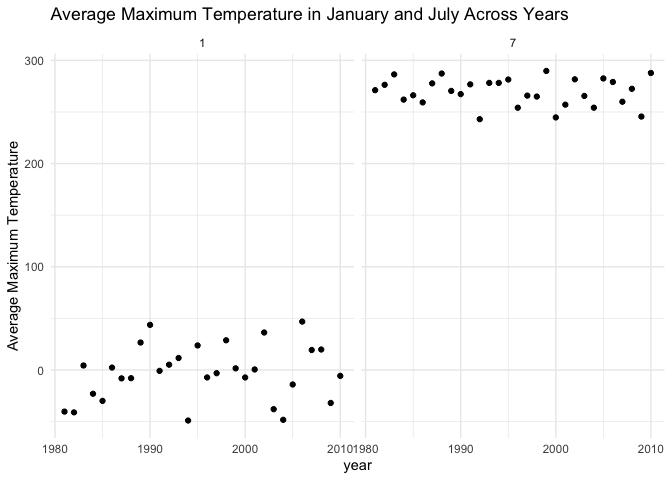
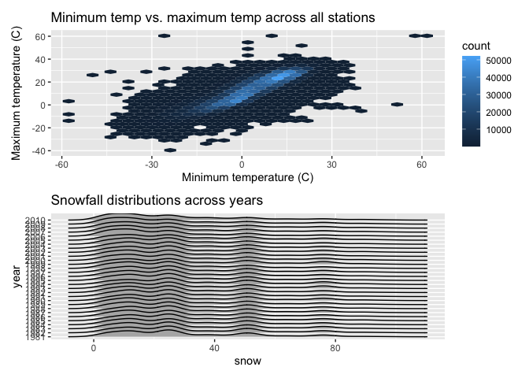
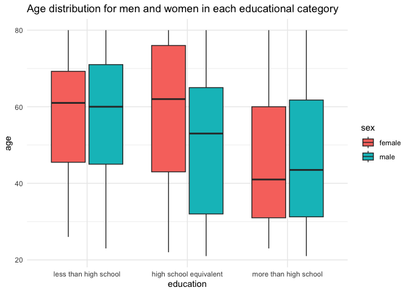
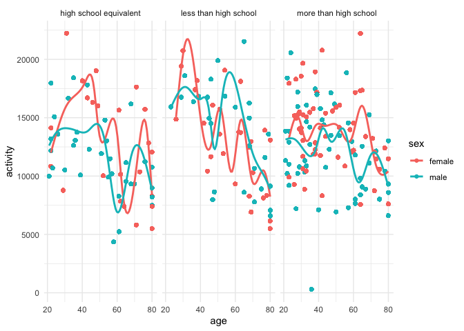
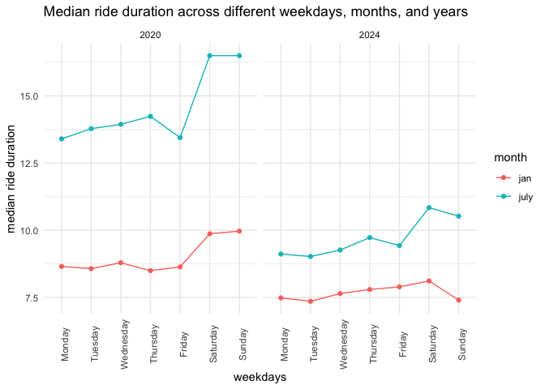
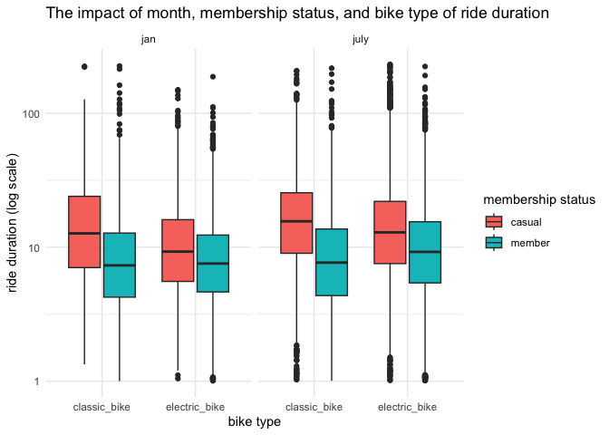

p8105_hw3_eej2124
================
Emma
2026-10-09

``` r
library(tidyverse)
library(patchwork)
library(ggridges)
```

# Problem 1

## Data import

``` r
library(p8105.datasets)

data("ny_noaa")
```

This dataset has 7 columns and 2595176 rows. It has a number of
variables to show weather data from around the world. These variables
include the weather station `id`, the `date` when the measurements were
taken, and the measurements themselves, including precipitation `prcp`,
amount of snow `snow`, snow depth `snwd`, and maximum `tmax` and minimum
`tmin` temperatures. Missing data seems to be a significant issue in
this dataset, as many of the data is `NA`.

## Data Cleaning

``` r
noaa_df =
  ny_noaa |>  
  mutate(
    year = lubridate::year(date), 
    month = lubridate::month(date),
    day = lubridate::day(date), 
    prcp = as.numeric(prcp), 
    snow = as.numeric(snow),
    snwd = as.numeric(snwd), 
    tmax = as.numeric(tmax),
    tmin = as.numeric(tmin), 
    tmax = tmax / 10, 
    tmin = tmin / 10, 
    prcp = prcp / 10
    ) 
```

## Most commonly observed snowfall

``` r
noaa_df |> 
  group_by(snow) |> 
  summarise(
    n_snow = n()
  ) |> 
  arrange(desc(n_snow)) |> 
  head(10) |> 
  knitr::kable(digits = 2)
```

| snow |  n_snow |
|-----:|--------:|
|    0 | 2008508 |
|   NA |  381221 |
|   25 |   31022 |
|   13 |   23095 |
|   51 |   18274 |
|   76 |   10173 |
|    8 |    9962 |
|    5 |    9748 |
|   38 |    9197 |
|    3 |    8790 |

The most commonly observed value of snow is 0mm. This makes sense, as
snow does not fall most of the time.

## Average tmax across years in January and July

``` r
noaa_df |>
  filter(month == 1 | month == 7) |> 
  group_by(year, month) |> 
  summarize(
    avg_tmax = mean(tmax, na.rm = TRUE)
  ) |> 
  ggplot(aes(x = year, y = avg_tmax)) +
  geom_point() + 
  geom_smooth() +
  facet_grid(.~ month) +
  theme_minimal()  +
   labs(
    title = "Average Maximum Temperature in January and July Across Years",
    y = "Average Maximum Temperature"
  )
```

    ## `summarise()` has regrouped the output.
    ## `geom_smooth()` using method = 'loess' and formula = 'y ~ x'
    ## ℹ Summaries were computed grouped by year and month.
    ## ℹ Output is grouped by year.
    ## ℹ Use `summarise(.groups = "drop_last")` to silence this message.
    ## ℹ Use `summarise(.by = c(year, month))` for per-operation grouping
    ##   (`?dplyr::dplyr_by`) instead.

<!-- -->
This plot shows a clear distinction between the average maximum
temperatures in January compared to July across years. July temperatures
seem to have remained relatively steady between 1980 and 2010, but
January temperatures show a sharp increase in the 1980s before
plateauing.

## Two panel plot

``` r
tmax_v_tmin_plot = 
  noaa_df |>  
  ggplot(aes(x = tmin, y = tmax)) + 
  geom_hex() +
  labs(
    title = "Minimum temp vs. maximum temp across all stations",
    x = "Minimum temperature (C)",
    y = "Maximum temperature (C)"
  )

snow_plot = 
  noaa_df |> 
  filter(snow > 0, snow < 100) |> 
  mutate(
    year = factor(year)
    ) |> 
  ggplot(aes(x = snow, y = year)) + 
  geom_density_ridges() +
  labs(
    title = "Snowfall distributions across years"
  )

tmax_v_tmin_plot / snow_plot
```

    ## Warning: Removed 1136276 rows containing non-finite outside the scale range
    ## (`stat_binhex()`).

    ## Picking joint bandwidth of 3.76

<!-- -->

# Problem 2

## Import, clean, and tidy the data

``` r
demographic_df =
  read_csv("data/nhanes_demographics.csv",
           skip = 4,
           na = c("", "NA", ".")) |> 
  janitor::clean_names() |> 
  drop_na() |> 
  filter(age >= 21) |> 
  mutate(
    sex = case_match(
      sex, 
     1 ~ c("male"), 
     2 ~ c("female")), 
    education = case_match(
      education, 
      1 ~ c("less than high school"), 
      2 ~ c("high school equivalent"), 
      3 ~ c("more than high school")
    ))
```

    ## Rows: 250 Columns: 5
    ## ── Column specification ────────────────────────────────────────────────────────
    ## Delimiter: ","
    ## dbl (5): SEQN, sex, age, BMI, education
    ## 
    ## ℹ Use `spec()` to retrieve the full column specification for this data.
    ## ℹ Specify the column types or set `show_col_types = FALSE` to quiet this message.

    ## Warning: There was 1 warning in `mutate()`.
    ## ℹ In argument: `sex = case_match(sex, 1 ~ c("male"), 2 ~ c("female"))`.
    ## Caused by warning:
    ## ! `case_match()` was deprecated in dplyr 1.2.0.
    ## ℹ Please use `recode_values()` instead.

``` r
accelerometer_df = 
  read_csv("data/nhanes_accel.csv", 
           na = c("", "NA", ".")) |> 
  janitor::clean_names() |> 
  drop_na() |> 
  pivot_longer(
    min1:min1440, 
    names_to = "minute", 
    names_prefix = "min",
    values_to = "mims"
  )
```

    ## Rows: 250 Columns: 1441
    ## ── Column specification ────────────────────────────────────────────────────────
    ## Delimiter: ","
    ## dbl (1441): SEQN, min1, min2, min3, min4, min5, min6, min7, min8, min9, min1...
    ## 
    ## ℹ Use `spec()` to retrieve the full column specification for this data.
    ## ℹ Specify the column types or set `show_col_types = FALSE` to quiet this message.

## Merge the datasets

``` r
demo_accel_df = 
  left_join(demographic_df, accelerometer_df, by = "seqn")
```

## Making a reader-friendly table

``` r
demo_accel_df |> 
  group_by(education, sex) |> 
  summarize(
    n_people = n_distinct(seqn)
  ) |> 
  knitr::kable(digits = 2)
```

    ## `summarise()` has regrouped the output.
    ## ℹ Summaries were computed grouped by education and sex.
    ## ℹ Output is grouped by education.
    ## ℹ Use `summarise(.groups = "drop_last")` to silence this message.
    ## ℹ Use `summarise(.by = c(education, sex))` for per-operation grouping
    ##   (`?dplyr::dplyr_by`) instead.

| education              | sex    | n_people |
|:-----------------------|:-------|---------:|
| high school equivalent | female |       23 |
| high school equivalent | male   |       35 |
| less than high school  | female |       28 |
| less than high school  | male   |       27 |
| more than high school  | female |       59 |
| more than high school  | male   |       56 |

There are a similar number of men and women who have more than a high
school education, and a similar number of men and women who have less
than a high school education. Interestingly, many more men have a high
school equivalent education compared to women. More people have more
than a high school education compared to any other education category.

## Making a visualization

``` r
demo_accel_df |> 
  mutate(education = fct_relevel(education, c("less than high school", "high school equivalent", "more than high school"))) |>
  ggplot(aes(x = education, y = age, fill = sex)) +
  geom_boxplot() +
  labs(
    title = "Age distribution for men and women in each educational category"
  ) +
  viridis::scale_color_viridis(
    discrete = TRUE
  ) +
  theme_minimal()
```

<!-- -->
Both men and women who completed more than a high school education tend
to be younger than the compare groups, and both men and women who who
completed less than a high school education tend to be older than the
compare groups. Interestingly, of those who completed only a high school
equivalent of education, the women tend to be older and the men tend to
be younger.

## Total activity

``` r
demo_accel_df |>  
  group_by(seqn) |> 
  mutate(
    activity = sum(mims, na.rm = TRUE)) |> 
  ggplot(aes(x = age, y = activity, color = sex)) +
  geom_point() + 
  geom_smooth(se = FALSE) +
  facet_grid(. ~ education) +
  theme_minimal()
```

    ## `geom_smooth()` using method = 'gam' and formula = 'y ~ s(x, bs = "cs")'

<!-- -->
This plot shows general downward trends in activity levels across
education levels and sexes. However, there are large variations in
activity levels within each of these groups. Participants with more than
a high school education tend to have less change in activity level as
they age, although there is still a slight downward trend.

## Activity over the day

``` r
demo_accel_df |> 
  mutate(
    minute = as.numeric(minute)
  ) |> 
  group_by(minute, education, sex) |>
  summarize( 
    mean_mims = mean(mims, na.rm = TRUE)) |> 
  ggplot(aes(x = minute / 60, y = mean_mims, color = sex)) +
  geom_line() + 
  geom_smooth() +
  facet_grid(. ~ education) +
  scale_x_continuous(breaks = seq(0, 24, 6)) +
  labs(
    title = "24-hour activity time courses across  education level and sex",
    x = "Hour of day",
    y = "Mean MIMS"
  ) +
  theme_minimal()
```

    ## `summarise()` has regrouped the output.
    ## `geom_smooth()` using method = 'gam' and formula = 'y ~ s(x, bs = "cs")'
    ## ℹ Summaries were computed grouped by minute, education, and sex.
    ## ℹ Output is grouped by minute and education.
    ## ℹ Use `summarise(.groups = "drop_last")` to silence this message.
    ## ℹ Use `summarise(.by = c(minute, education, sex))` for per-operation grouping
    ##   (`?dplyr::dplyr_by`) instead.

<!-- -->
This plot shows the activity levels of participants over the course of
24 hours, across each education level and sex. In general, women tend to
have higher activity levels than men. Those with less than a high school
education have higher activity level peaks earlier in the day than those
with more than a high school education or with a high school education
equivalent. However, those with more than a high school education have
more sustained activity throughout the day than other education levels.

# Problem 3

## Import and clean data

``` r
jan2020_df = 
  read_csv("data/citibike/Jan 2020 Citi.csv", 
           na = c("", "NA", ".")) |> 
  janitor::clean_names() |> 
  mutate(month = "jan", 
         year = "2020") 
```

    ## Rows: 12420 Columns: 7
    ## ── Column specification ────────────────────────────────────────────────────────
    ## Delimiter: ","
    ## chr (6): ride_id, rideable_type, weekdays, start_station_name, end_station_n...
    ## dbl (1): duration
    ## 
    ## ℹ Use `spec()` to retrieve the full column specification for this data.
    ## ℹ Specify the column types or set `show_col_types = FALSE` to quiet this message.

``` r
jan2024_df = 
  read_csv("data/citibike/Jan 2024 Citi.csv", 
           na = c("", "NA", ".")) |> 
  janitor::clean_names()|> 
  mutate(month = "jan", 
         year = "2024") 
```

    ## Rows: 18861 Columns: 7
    ## ── Column specification ────────────────────────────────────────────────────────
    ## Delimiter: ","
    ## chr (6): ride_id, rideable_type, weekdays, start_station_name, end_station_n...
    ## dbl (1): duration
    ## 
    ## ℹ Use `spec()` to retrieve the full column specification for this data.
    ## ℹ Specify the column types or set `show_col_types = FALSE` to quiet this message.

``` r
july2020_df = 
  read_csv("data/citibike/July 2020 Citi.csv", 
           na = c("", "NA", ".")) |> 
  janitor::clean_names() |> 
  mutate(month = "july",
         year = "2020") 
```

    ## Rows: 21048 Columns: 7
    ## ── Column specification ────────────────────────────────────────────────────────
    ## Delimiter: ","
    ## chr (6): ride_id, rideable_type, weekdays, start_station_name, end_station_n...
    ## dbl (1): duration
    ## 
    ## ℹ Use `spec()` to retrieve the full column specification for this data.
    ## ℹ Specify the column types or set `show_col_types = FALSE` to quiet this message.

``` r
july2024_df = 
  read_csv("data/citibike/July 2024 Citi.csv", 
           na = c("", "NA", ".")) |> 
  janitor::clean_names() |> 
  mutate(month = "july", 
         year = "2024") 
```

    ## Rows: 47156 Columns: 7
    ## ── Column specification ────────────────────────────────────────────────────────
    ## Delimiter: ","
    ## chr (6): ride_id, rideable_type, weekdays, start_station_name, end_station_n...
    ## dbl (1): duration
    ## 
    ## ℹ Use `spec()` to retrieve the full column specification for this data.
    ## ℹ Specify the column types or set `show_col_types = FALSE` to quiet this message.

## Binding Rows

``` r
citi_bikes_df = 
  bind_rows(jan2020_df, july2020_df, jan2024_df, july2024_df) |> 
  relocate(month, year) |> 
  drop_na()
```

## Table 1

``` r
citi_bikes_df |> 
  group_by(month, year, member_casual) |> 
  summarize(
    rides = n()
  ) |> 
  knitr::kable(digits = 2)
```

    ## `summarise()` has regrouped the output.
    ## ℹ Summaries were computed grouped by month, year, and member_casual.
    ## ℹ Output is grouped by month and year.
    ## ℹ Use `summarise(.groups = "drop_last")` to silence this message.
    ## ℹ Use `summarise(.by = c(month, year, member_casual))` for per-operation
    ##   grouping (`?dplyr::dplyr_by`) instead.

| month | year | member_casual | rides |
|:------|:-----|:--------------|------:|
| jan   | 2020 | casual        |   980 |
| jan   | 2020 | member        | 11418 |
| jan   | 2024 | casual        |  2094 |
| jan   | 2024 | member        | 16705 |
| july  | 2020 | casual        |  5625 |
| july  | 2020 | member        | 15388 |
| july  | 2024 | casual        | 10843 |
| july  | 2024 | member        | 36200 |

This table shows that the total number of rides occurring increased over
4 years, at least doubling in most cases, showing an increase in
popularity of Citi Bikes. In both 2020 and 2024, there were more riders
of all types in the summer, but casual riders specifically significantly
increased.

## Most popular starting stations

``` r
citi_bikes_df |> 
  filter(month == "july", year == "2024") |> 
  group_by(start_station_name) |> 
  summarize(
    rides = n()) |> 
  arrange(desc(rides)) |> 
  slice_head(n = 5) |> 
  knitr::kable(digits = 2)
```

| start_station_name       | rides |
|:-------------------------|------:|
| Pier 61 at Chelsea Piers |   163 |
| University Pl & E 14 St  |   155 |
| W 21 St & 6 Ave          |   152 |
| West St & Chambers St    |   150 |
| W 31 St & 7 Ave          |   145 |

In July 2024, the most popular start station was Pier 61 at Chelsea
Piers, with 163 total rides occurring.

## Plot of effect of weekday, month, and year on median ride duration

``` r
citi_bikes_df |> 
  group_by(weekdays, month, year) |> 
  summarize(
    median_duration = median(duration, na.rm = TRUE)
  ) |> 
  ggplot(aes(x = weekdays, y = median_duration, color = month, group = month)) +
  geom_point() +
  geom_line () +
  theme_minimal() +
  theme(axis.text.x = element_text(angle = 90)) +
  facet_grid(. ~year) +
   labs(
    title = "Median ride duration across different weekdays, months, and years",
    y = "median ride duration"
  ) +
  scale_x_discrete(limits = c("Monday", "Tuesday", "Wednesday", "Thursday", "Friday", "Saturday", "Sunday"))
```

    ## `summarise()` has regrouped the output.
    ## ℹ Summaries were computed grouped by weekdays, month, and year.
    ## ℹ Output is grouped by weekdays and month.
    ## ℹ Use `summarise(.groups = "drop_last")` to silence this message.
    ## ℹ Use `summarise(.by = c(weekdays, month, year))` for per-operation grouping
    ##   (`?dplyr::dplyr_by`) instead.

<!-- -->
Interestingly, the median ride duration decreased in both January and
July from 2020 to 2024. This may be a result of increasing prices for
longer Citi Bike rides. In July, ride duration tends to be longer, most
likely due to the warmer weather. For both January and July in 2020 and
2024, the longest median ride duration occurs on Saturday. The weekend
tends to have longer ride duration, except for Sunday in January 2024,
which has significantly shorter ride durations.

## Plot of the impact of month, membership status, and bike type of ride duration

``` r
citi_bikes_df |> 
  filter(year == "2024", duration > 0) |> 
  ggplot(aes(x = rideable_type, y = duration, fill = member_casual)) +
  geom_boxplot() +
  scale_y_log10() +
  facet_grid(.~ month) +
  labs(
    title = "The impact of month, membership status, and bike type of ride duration",
    x = "bike type",
    y = "ride duration (log scale)",
    fill = "membership status"
  ) +
  theme_minimal()
```

<!-- -->
There were many ride duration data point outliers in this data set, most
likely due to improper docking. These dramatically skewed the plot. In
order to better interpret the data, I changed the ride duration to a log
scale. For Citi Bike members, bike type and month do not have huge
impacts on ride duration. This may be because members tend to use Citi
Bikes more regularly, for purposes like commuting, which has a similar
duration year round. However, for casual riders, ride duration is longer
on classic bikes, which are less expensive than electric bikes, and in
July, which is better weather for biking than January.
