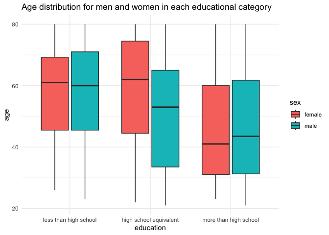
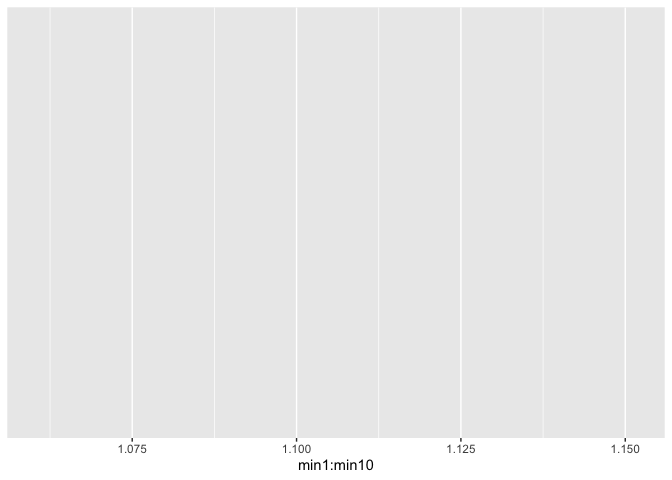

p8105_hw3_eej2124
================
Emma
2026-10-09

``` r
library(tidyverse)
library(patchwork)
```

# Problem 1

``` r
library(p8105.datasets)

data("ny_noaa")
```

# Problem 2

## Import, clean, and tidy the data

``` r
demographic_df =
  read_csv("data/nhanes_demographics.csv",
           skip = 4,
           na = c("", "NA", ".")) |> 
  janitor::clean_names() |> 
  drop_na() |> 
  filter(age >= 21) |> 
  mutate(
    sex = case_match(
      sex, 
     1 ~ c("male"), 
     2 ~ c("female")), 
    education = case_match(
      education, 
      1 ~ c("less than high school"), 
      2 ~ c("high school equivalent"), 
      3 ~ c("more than high school")
    ))
```

    ## Rows: 250 Columns: 5
    ## ── Column specification ────────────────────────────────────────────────────────
    ## Delimiter: ","
    ## dbl (5): SEQN, sex, age, BMI, education
    ## 
    ## ℹ Use `spec()` to retrieve the full column specification for this data.
    ## ℹ Specify the column types or set `show_col_types = FALSE` to quiet this message.

    ## Warning: There was 1 warning in `mutate()`.
    ## ℹ In argument: `sex = case_match(sex, 1 ~ c("male"), 2 ~ c("female"))`.
    ## Caused by warning:
    ## ! `case_match()` was deprecated in dplyr 1.2.0.
    ## ℹ Please use `recode_values()` instead.

``` r
accelerometer_df = 
  read_csv("data/nhanes_accel.csv", 
           na = c("", "NA", ".")) |> 
  janitor::clean_names() |> 
  drop_na()
```

    ## Rows: 250 Columns: 1441
    ## ── Column specification ────────────────────────────────────────────────────────
    ## Delimiter: ","
    ## dbl (1441): SEQN, min1, min2, min3, min4, min5, min6, min7, min8, min9, min1...
    ## 
    ## ℹ Use `spec()` to retrieve the full column specification for this data.
    ## ℹ Specify the column types or set `show_col_types = FALSE` to quiet this message.

## Merge the datasets

``` r
demo_accel_df = 
  left_join(demographic_df, accelerometer_df, by = "seqn")
```

## Making a reader-friendly table

``` r
demo_accel_df |> 
  group_by(education, sex) |> 
  summarize(
    count= n()
  ) |> 
  knitr::kable(digits = 2)
```

    ## `summarise()` has regrouped the output.
    ## ℹ Summaries were computed grouped by education and sex.
    ## ℹ Output is grouped by education.
    ## ℹ Use `summarise(.groups = "drop_last")` to silence this message.
    ## ℹ Use `summarise(.by = c(education, sex))` for per-operation grouping
    ##   (`?dplyr::dplyr_by`) instead.

| education              | sex    | count |
|:-----------------------|:-------|------:|
| high school equivalent | female |    23 |
| high school equivalent | male   |    35 |
| less than high school  | female |    28 |
| less than high school  | male   |    27 |
| more than high school  | female |    59 |
| more than high school  | male   |    56 |

There are a similar number of men and women who have more than a high
school education, and a similar number of men and women who have less
than a high school education. Interestingly, many more men have a high
school equivalent education compared to women. More people have more
than a high school education compared to any other education category.

## Making a visualization

``` r
demo_accel_df |> 
  mutate(education = fct_relevel(education, c("less than high school", "high school equivalent", "more than high school"))) |>
  ggplot(aes(x = education, y = age, fill = sex)) +
  geom_boxplot() +
  labs(
    title = "Age distribution for men and women in each educational category"
  ) +
  viridis::scale_color_viridis(
    discrete = TRUE
  ) +
  theme_minimal()
```

<!-- -->
Both men and women who completed more than a high school education tend
to be younger than the compare groups, and both men and women who who
completed less than a high school education tend to be older than the
compare groups. Interestingly, of those who completed only a high school
equivalent of education, the women tend to be older and the men tend to
be younger.

## Total activity

``` r
demo_accel_df |> 
  mutate(activity = sum(min1:min1440))
```

    ## Warning: There was 1 warning in `mutate()`.
    ## ℹ In argument: `activity = sum(min1:min1440)`.
    ## Caused by warning in `min1:min1440`:
    ## ! numerical expression has 228 elements: only the first used

    ## # A tibble: 228 × 1,446
    ##     seqn sex      age   bmi education     min1   min2   min3  min4   min5   min6
    ##    <dbl> <chr>  <dbl> <dbl> <chr>        <dbl>  <dbl>  <dbl> <dbl>  <dbl>  <dbl>
    ##  1 62161 male      22  23.3 high school… 1.11  3.12   1.47   0.938 1.60   0.145 
    ##  2 62164 female    44  23.2 more than h… 1.92  1.67   2.38   0.935 2.59   5.22  
    ##  3 62169 male      21  20.1 high school… 5.85  5.18   4.76   6.48  6.85   7.24  
    ##  4 62174 male      80  33.9 more than h… 5.42  3.48   3.72   3.81  6.85   4.45  
    ##  5 62177 male      51  20.1 high school… 6.14  8.06   9.99   6.60  4.57   2.78  
    ##  6 62178 male      80  28.5 high school… 0.167 0.429  0.131  1.20  0.0796 0.0487
    ##  7 62180 male      35  27.9 more than h… 0.039 0      0      0     0.369  0.265 
    ##  8 62184 male      26  22.1 high school… 1.55  2.81   3.86   4.76  6.10   7.61  
    ##  9 62189 female    30  22.4 more than h… 2.81  0.195  0.163  0     0.144  0.180 
    ## 10 62199 male      57  28   more than h… 0.031 0.0359 0.0387 0.079 0.109  0.262 
    ## # ℹ 218 more rows
    ## # ℹ 1,435 more variables: min7 <dbl>, min8 <dbl>, min9 <dbl>, min10 <dbl>,
    ## #   min11 <dbl>, min12 <dbl>, min13 <dbl>, min14 <dbl>, min15 <dbl>,
    ## #   min16 <dbl>, min17 <dbl>, min18 <dbl>, min19 <dbl>, min20 <dbl>,
    ## #   min21 <dbl>, min22 <dbl>, min23 <dbl>, min24 <dbl>, min25 <dbl>,
    ## #   min26 <dbl>, min27 <dbl>, min28 <dbl>, min29 <dbl>, min30 <dbl>,
    ## #   min31 <dbl>, min32 <dbl>, min33 <dbl>, min34 <dbl>, min35 <dbl>, …

# how do i sum all mins?

## Activity over the day

``` r
demo_accel_df |> 
  group_by(education, sex) |> 
  ggplot(aes(x = min1:min10, y = ))
```

    ## Warning in min1:min10: numerical expression has 228 elements: only the first
    ## used

<!-- -->

# Problem 3

## Import and clean data

``` r
jan2020_df = 
  read_csv("data/citibike/Jan 2020 Citi.csv", 
           na = c("", "NA", ".")) |> 
  janitor::clean_names() |> 
  mutate(date = "jan2020") 
```

    ## Rows: 12420 Columns: 7
    ## ── Column specification ────────────────────────────────────────────────────────
    ## Delimiter: ","
    ## chr (6): ride_id, rideable_type, weekdays, start_station_name, end_station_n...
    ## dbl (1): duration
    ## 
    ## ℹ Use `spec()` to retrieve the full column specification for this data.
    ## ℹ Specify the column types or set `show_col_types = FALSE` to quiet this message.

``` r
jan2024_df = 
  read_csv("data/citibike/Jan 2024 Citi.csv", 
           na = c("", "NA", ".")) |> 
  janitor::clean_names()|> 
  mutate(date = "jan2024") 
```

    ## Rows: 18861 Columns: 7
    ## ── Column specification ────────────────────────────────────────────────────────
    ## Delimiter: ","
    ## chr (6): ride_id, rideable_type, weekdays, start_station_name, end_station_n...
    ## dbl (1): duration
    ## 
    ## ℹ Use `spec()` to retrieve the full column specification for this data.
    ## ℹ Specify the column types or set `show_col_types = FALSE` to quiet this message.

``` r
july2020_df = 
  read_csv("data/citibike/July 2020 Citi.csv", 
           na = c("", "NA", ".")) |> 
  janitor::clean_names() |> 
  mutate(date = "july2020") 
```

    ## Rows: 21048 Columns: 7
    ## ── Column specification ────────────────────────────────────────────────────────
    ## Delimiter: ","
    ## chr (6): ride_id, rideable_type, weekdays, start_station_name, end_station_n...
    ## dbl (1): duration
    ## 
    ## ℹ Use `spec()` to retrieve the full column specification for this data.
    ## ℹ Specify the column types or set `show_col_types = FALSE` to quiet this message.

``` r
july2024_df = 
  read_csv("data/citibike/July 2024 Citi.csv", 
           na = c("", "NA", ".")) |> 
  janitor::clean_names() |> 
  mutate(date = "july2024") 
```

    ## Rows: 47156 Columns: 7
    ## ── Column specification ────────────────────────────────────────────────────────
    ## Delimiter: ","
    ## chr (6): ride_id, rideable_type, weekdays, start_station_name, end_station_n...
    ## dbl (1): duration
    ## 
    ## ℹ Use `spec()` to retrieve the full column specification for this data.
    ## ℹ Specify the column types or set `show_col_types = FALSE` to quiet this message.

\#Do i need to tidy more?

## Bind Rows

``` r
citi_bikes_df = 
  bind_rows(jan2020_df, july2020_df, jan2024_df, july2024_df) |> 
  relocate(date)
```

## Table 1

``` r
citi_bikes_df |> 
  group_by(date, member_casual) |> 
  summarize(
    rides = n()
  ) |> 
  knitr::kable(digits = 2)
```

    ## `summarise()` has regrouped the output.
    ## ℹ Summaries were computed grouped by date and member_casual.
    ## ℹ Output is grouped by date.
    ## ℹ Use `summarise(.groups = "drop_last")` to silence this message.
    ## ℹ Use `summarise(.by = c(date, member_casual))` for per-operation grouping
    ##   (`?dplyr::dplyr_by`) instead.

| date     | member_casual | rides |
|:---------|:--------------|------:|
| jan2020  | casual        |   984 |
| jan2020  | member        | 11436 |
| jan2024  | casual        |  2108 |
| jan2024  | member        | 16753 |
| july2020 | casual        |  5637 |
| july2020 | member        | 15411 |
| july2024 | casual        | 10894 |
| july2024 | member        | 36262 |

This table shows that… number of total rides increased over 4 years
(more than double), more riders in the summer, especially more casual
riders in the summer

## Table 2

``` r
#citi_bikes_df |> 
#  filter(date = "july2024") |> 
#  group_by(start_station_name) |> 
 # summarize(
 #   rides = n())
```
